# El mapa

Veinticinco niveles de cuatro salas: **cien salas, y ninguna se repite**.
Comparadas casilla a casilla, las cien salen distintas, y todas estan dibujadas
desde los bytes de la ROM, ni una captura.

Cada sala son 32x20 casillas que salen de ochenta bytes apuntando a bloques de
8x4; se descomprimen, y encima se planta -en el sitio exacto en el que el
cartucho la planta- cada cosa de las dos listas del nivel: las jaulas, las
puertas, los peligros, los bichos y el objeto escondido. Las **64.000
casillas** caben en **2.983 bytes** del cartucho; como, esta contado en [El
codigo](EL-CODIGO.html).

Las cuatro salas de un nivel van puestas donde el cartucho las pone: el reparto
que le da `0x52DB`, que no es el mismo en todos -hay columnas, filas, 2x2 y
catorce formas raras-. Montadas asi, las plataformas y las escaleras siguen de
una sala a la de al lado, y por eso las salas van pegadas, sin rotulo en medio.
Las jaulas van **abiertas, ensenando lo que guardan** -el amigo o el frasco-
pero con sus candados puestos, que es un dibujo que el cartucho no pinta nunca:
abierta, a la jaula no le queda ningun candado.

Debajo de cada nivel va solo lo que el dibujo no dice: cuantas llaves hay, que
guarda cada jaula, cual es el objeto escondido y a que nivel lleva cada puerta
de calavera. Las salas se numeran en el orden de lectura del reparto: en un
2x2, la sala 1 es la de arriba a la izquierda y la 4 la de abajo a la derecha.

Delante de cada ronda va **el minimapa de sus cinco niveles**, a 1:1 para
poder ampliarlo, con las puertas de calavera unidas. Las rayas pasan por
detras de los niveles, para no ensuciar las salas.

*Esta seccion se rehizo tras el [issue
#3](https://github.com/antxiko/Goonies-disassembly/issues/3) de
**[theNestruo](https://github.com/theNestruo)**: el plano sin rotulos, las
jaulas abiertas, las listas reducidas a lo que la imagen no dice y los minimapas
a 1:1 con las rayas detras. Todo lo de esta pagina sale de ahi.*

## Ronda 1 — niveles 1 a 5

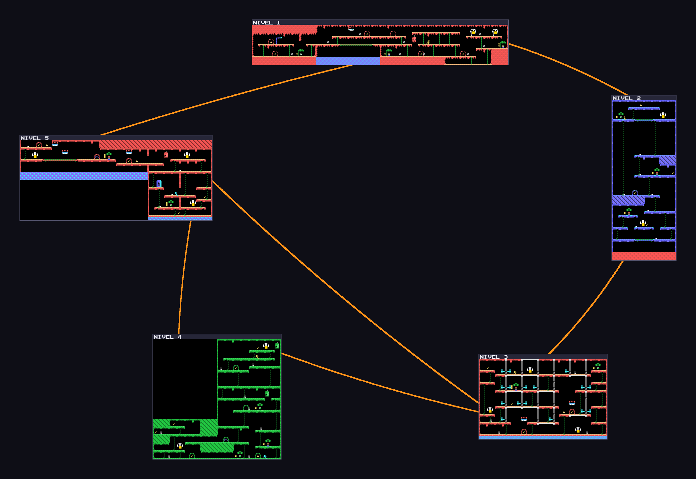

*Los cinco niveles de la ronda 1 y sus puertas de calavera, a 1:1. Cada nivel esta puesto con el reparto de salas que le da 0x52DB, y cada raya une DOS puertas que se emparejan de verdad: la puerta j del nivel A dice (B, k) y la puerta k del nivel B dice (A, j). Las 64 del cartucho emparejan asi, y ninguna sale de su ronda. Las rayas van por detras de los niveles; la marca amarilla es la puerta. Dos cosas de este dibujo NO salen de la ROM, y por eso se dicen: el sitio de cada nivel en el anillo -de los doce ordenes posibles se elige el que menos cruces deja- y la comba de las curvas, que separa las parejas de niveles unidas por DOS puertas.*

### Nivel 1

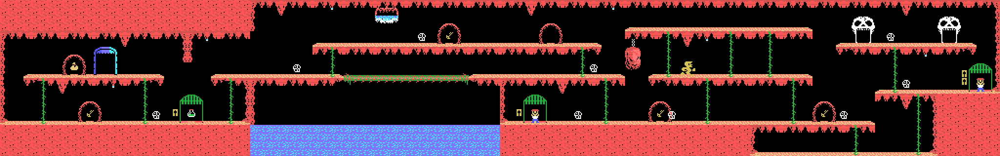

*Nivel 1, las cuatro salas en fila. Llaves: cuatro, una en la sala 1, una en la 2, una en la 3 y una en la 4. Jaulas: un frasco con un candado en la sala 1, un amigo con un candado en la sala 3 y un amigo con dos candados en la sala 4. Objeto escondido:  en la sala 1. Puertas de calavera: al nivel 2 desde la sala 4 y al nivel 5 desde la sala 4.*

### Nivel 2

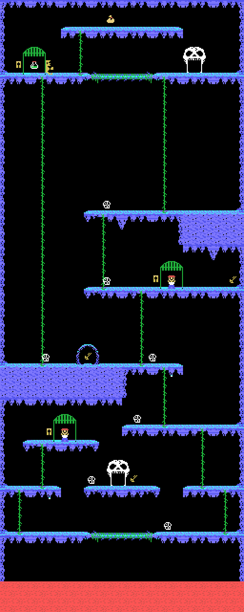

*Nivel 2, las cuatro salas en columna. Llaves: tres, una en la sala 2, una en la 3 y una en la 4. Jaulas: un frasco con un candado en la sala 1, un amigo con un candado en la sala 2 y un amigo con un candado en la sala 3. Objeto escondido:  en la sala 1. Puertas de calavera: al nivel 1 desde la sala 1 y al nivel 3 desde la sala 4.*

### Nivel 3

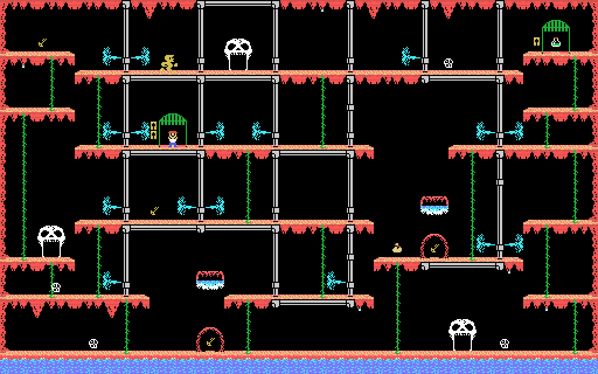

*Nivel 3, las cuatro salas en 2x2. Llaves: cuatro, una en la sala 1, dos en la 3 y una en la 4. Jaulas: un amigo con dos candados en la sala 1 y un frasco con un candado en la sala 2. Objeto escondido:  en la sala 4. Puertas de calavera: al nivel 2 desde la sala 1, al nivel 5 desde la sala 3, y al nivel 4 desde la sala 4.*

### Nivel 4

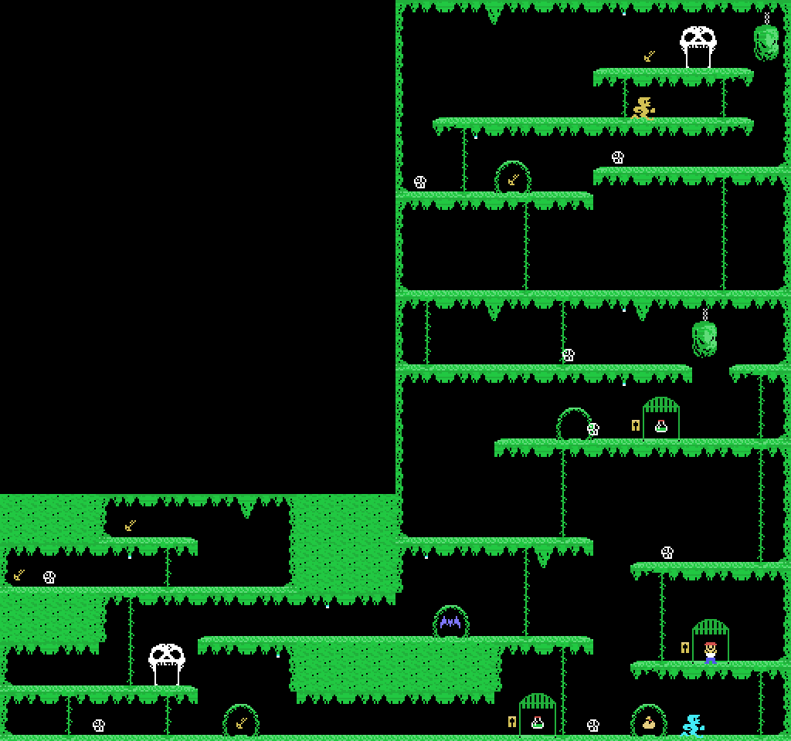

*Nivel 4, las salas repartidas `-1 / -2 / 34`. Llaves: cinco, dos en la sala 1 y tres en la 3. Jaulas: un frasco con un candado en la sala 2, un amigo con un candado en la sala 4 y un frasco con un candado en la sala 4. Objeto escondido:  en la sala 4. Puertas de calavera: al nivel 3 desde la sala 1 y al nivel 5 desde la sala 3.*

### Nivel 5

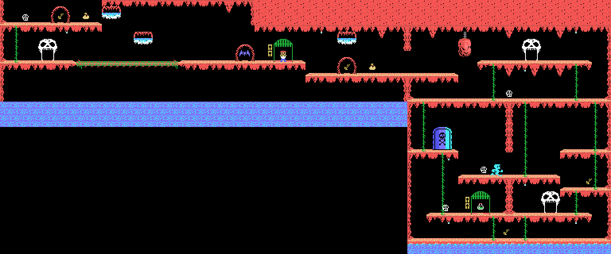

*Nivel 5, las salas repartidas `123 / --4`. Llaves: cuatro, una en la sala 1, una en la 2 y dos en la 4. Jaulas: un amigo con dos candados en la sala 2 y un frasco con dos candados en la sala 4. Objetos escondidos:  en la sala 1 y puntos en la sala 2. Puertas de calavera: al nivel 1 desde la sala 1, al nivel 3 desde la sala 3, y al nivel 4 desde la sala 4. Puerta de salida: al nivel 6, el primero de la ronda 2, en la sala 4.*

## Ronda 2 — niveles 6 a 10

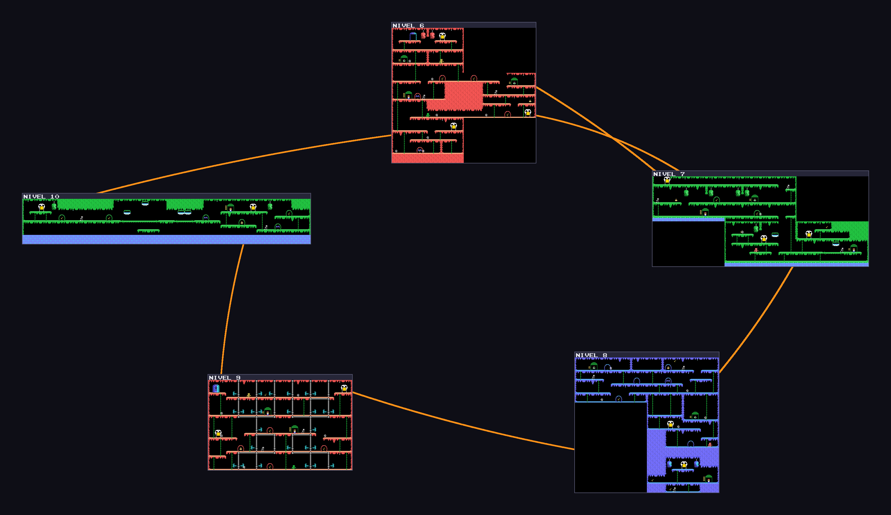

*Los cinco niveles de la ronda 2 y sus puertas de calavera, a 1:1. Cada nivel esta puesto con el reparto de salas que le da 0x52DB, y cada raya une DOS puertas que se emparejan de verdad: la puerta j del nivel A dice (B, k) y la puerta k del nivel B dice (A, j). Las 64 del cartucho emparejan asi, y ninguna sale de su ronda. Las rayas van por detras de los niveles; la marca amarilla es la puerta. Dos cosas de este dibujo NO salen de la ROM, y por eso se dicen: el sitio de cada nivel en el anillo -de los doce ordenes posibles se elige el que menos cruces deja- y la comba de las curvas, que separa las parejas de niveles unidas por DOS puertas.*

### Nivel 6

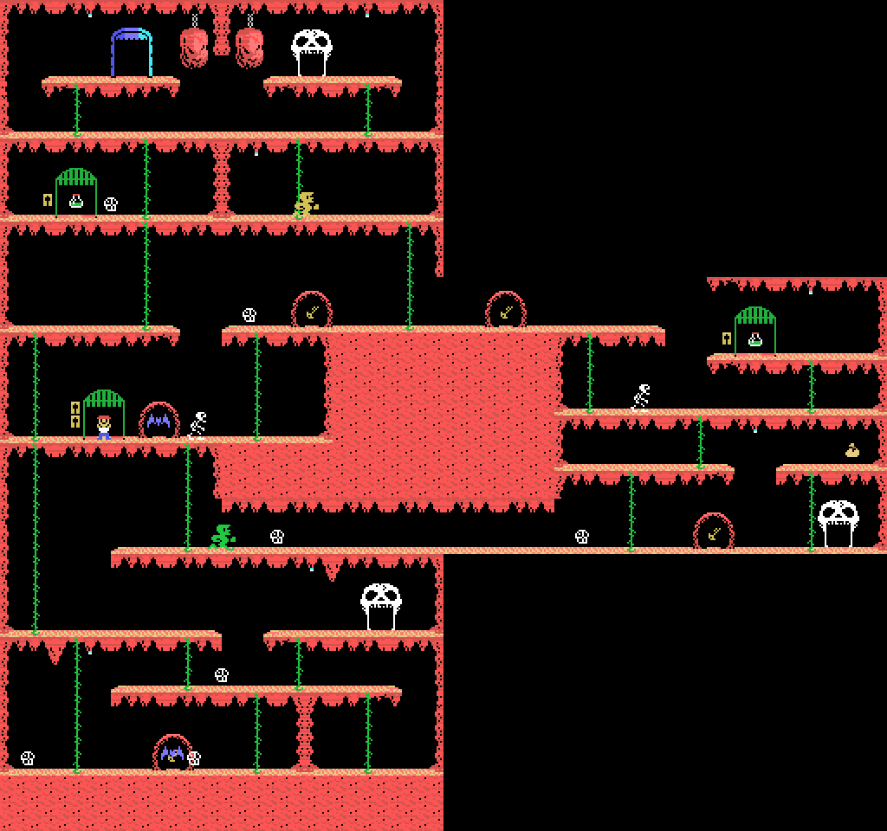

*Nivel 6, las salas repartidas `1- / 23 / 4-`. Llaves: cuatro, una en la sala 2, dos en la 3 y una en la 4. Jaulas: un frasco con un candado en la sala 1, un amigo con dos candados en la sala 2 y un frasco con un candado en la sala 3. Objeto escondido: puntos en la sala 3. Puertas de calavera: al nivel 7 desde las salas 1 y 3, y al nivel 10 desde la sala 4.*

### Nivel 7

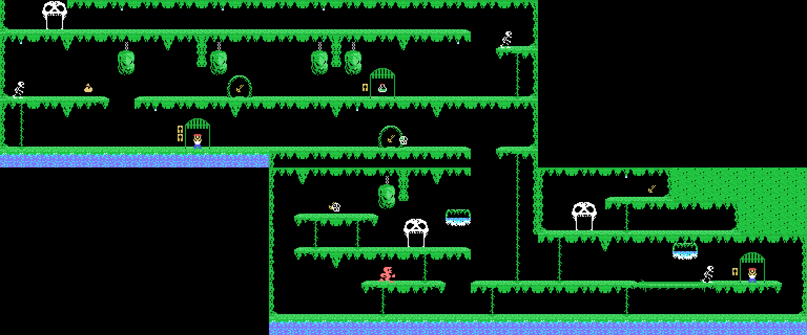

*Nivel 7, las salas repartidas `12- / -34`. Llaves: cuatro, una en la sala 1, una en la 2, una en la 3 y una en la 4. Jaulas: un amigo con dos candados en la sala 1, un frasco con un candado en la sala 2 y un amigo con un candado en la sala 4. Objeto escondido:  en la sala 1. Puertas de calavera: al nivel 6 desde las salas 1 y 3, y al nivel 8 desde la sala 4.*

### Nivel 8

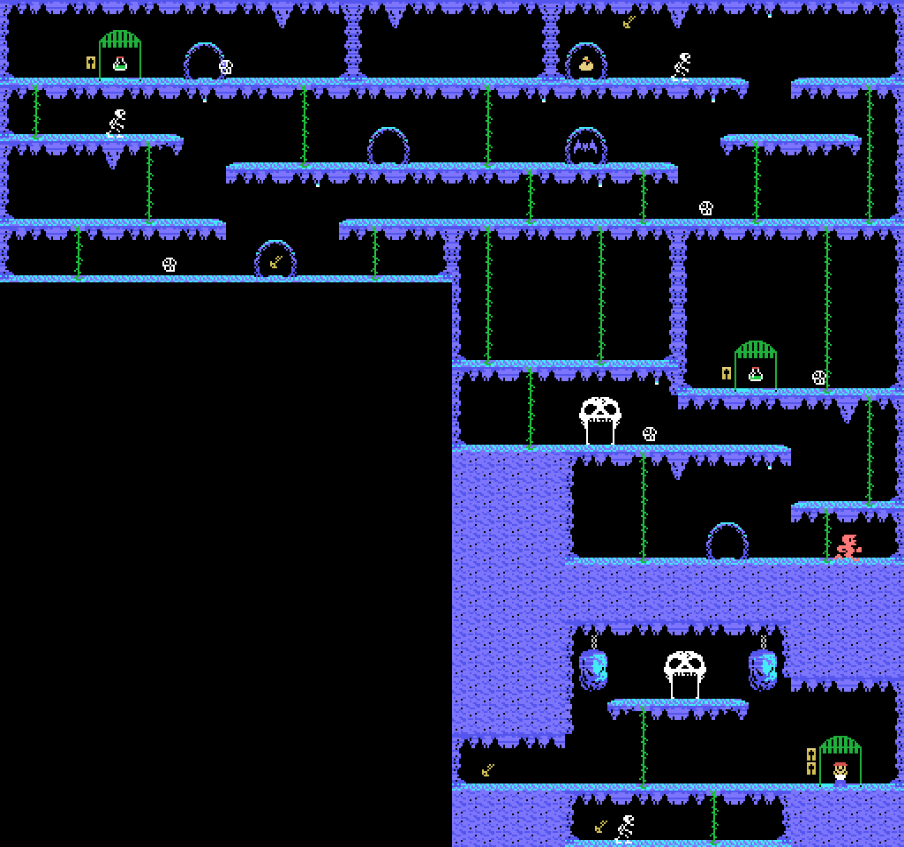

*Nivel 8, las salas repartidas `12 / -3 / -4`. Llaves: cuatro, una en la sala 1, una en la 2 y dos en la 4. Jaulas: un frasco con un candado en la sala 1, un frasco con un candado en la sala 3 y un amigo con dos candados en la sala 4. Objeto escondido:  en la sala 2. Puertas de calavera: al nivel 7 desde la sala 3 y al nivel 9 desde la sala 4.*

### Nivel 9

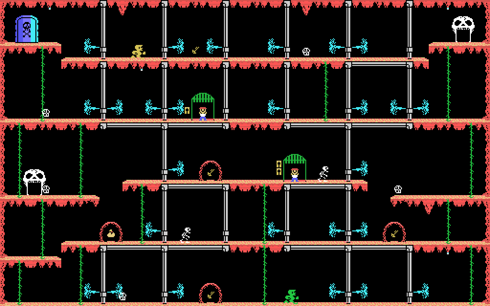

*Nivel 9, las cuatro salas en 2x2. Llaves: cuatro, una en la sala 1, dos en la 3 y una en la 4. Jaulas: un amigo con un candado en la sala 1 y un amigo con dos candados en la sala 4. Objeto escondido:  en la sala 3. Puertas de calavera: al nivel 8 desde la sala 2 y al nivel 10 desde la sala 3. Puerta de salida: al nivel 11, el primero de la ronda 3, en la sala 1.*

### Nivel 10

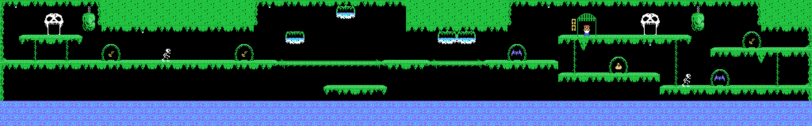

*Nivel 10, las cuatro salas en fila. Llaves: tres, una en la sala 1, una en la 2 y una en la 4. Jaulas: un amigo con dos candados en la sala 3. Objeto escondido:  en la sala 4. Puertas de calavera: al nivel 6 desde la sala 1 y al nivel 9 desde la sala 4.*

## Ronda 3 — niveles 11 a 15

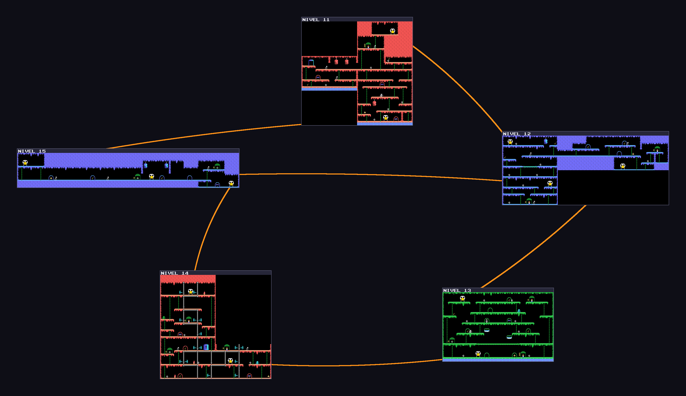

*Los cinco niveles de la ronda 3 y sus puertas de calavera, a 1:1. Cada nivel esta puesto con el reparto de salas que le da 0x52DB, y cada raya une DOS puertas que se emparejan de verdad: la puerta j del nivel A dice (B, k) y la puerta k del nivel B dice (A, j). Las 64 del cartucho emparejan asi, y ninguna sale de su ronda. Las rayas van por detras de los niveles; la marca amarilla es la puerta. Dos cosas de este dibujo NO salen de la ROM, y por eso se dicen: el sitio de cada nivel en el anillo -de los doce ordenes posibles se elige el que menos cruces deja- y la comba de las curvas, que separa las parejas de niveles unidas por DOS puertas.*

### Nivel 11

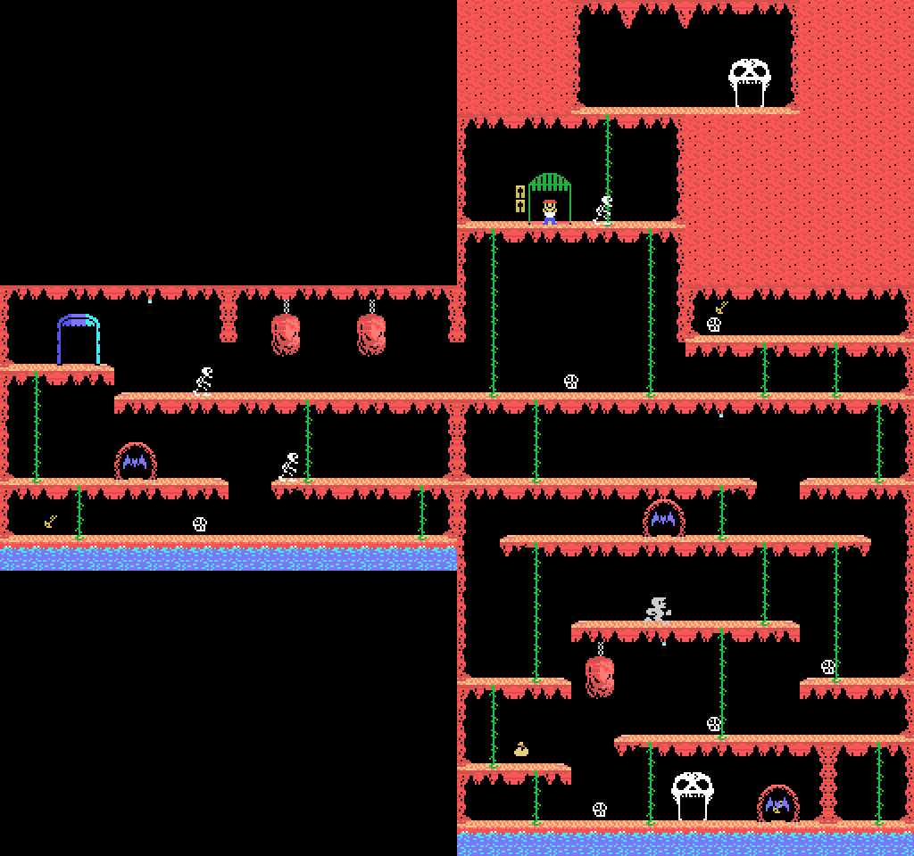

*Nivel 11, las salas repartidas `-1 / 23 / -4`. Llaves: tres, una en la sala 2, una en la 3 y una en la 4. Jaulas: un amigo con dos candados en la sala 1. Objeto escondido:  en la sala 4. Puertas de calavera: al nivel 12 desde la sala 1 y al nivel 15 desde la sala 4.*

### Nivel 12

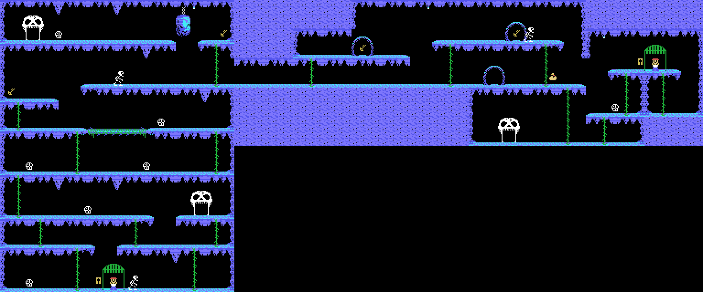

*Nivel 12, las salas repartidas `123 / 4--`. Llaves: cuatro, dos en la sala 1, una en la 2 y una en la 3. Jaulas: un amigo con un candado en la sala 3 y un amigo con un candado en la sala 4. Objeto escondido:  en la sala 3. Puertas de calavera: al nivel 11 desde la sala 1, al nivel 13 desde la sala 3, y al nivel 15 desde la sala 4.*

### Nivel 13

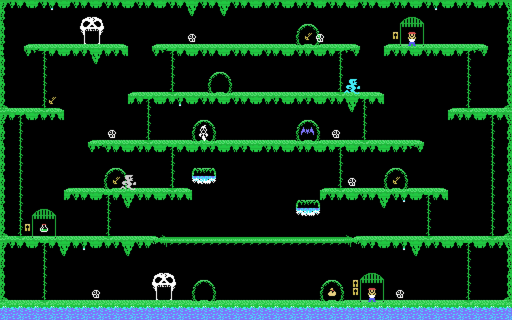

*Nivel 13, las cuatro salas en 2x2. Llaves: cuatro, una en la sala 1, una en la 2, una en la 3 y una en la 4. Jaulas: un amigo con un candado en la sala 2, un frasco con un candado en la sala 3 y un amigo con dos candados en la sala 4. Objeto escondido:  en la sala 4. Puertas de calavera: al nivel 12 desde la sala 1 y al nivel 14 desde la sala 3.*

### Nivel 14

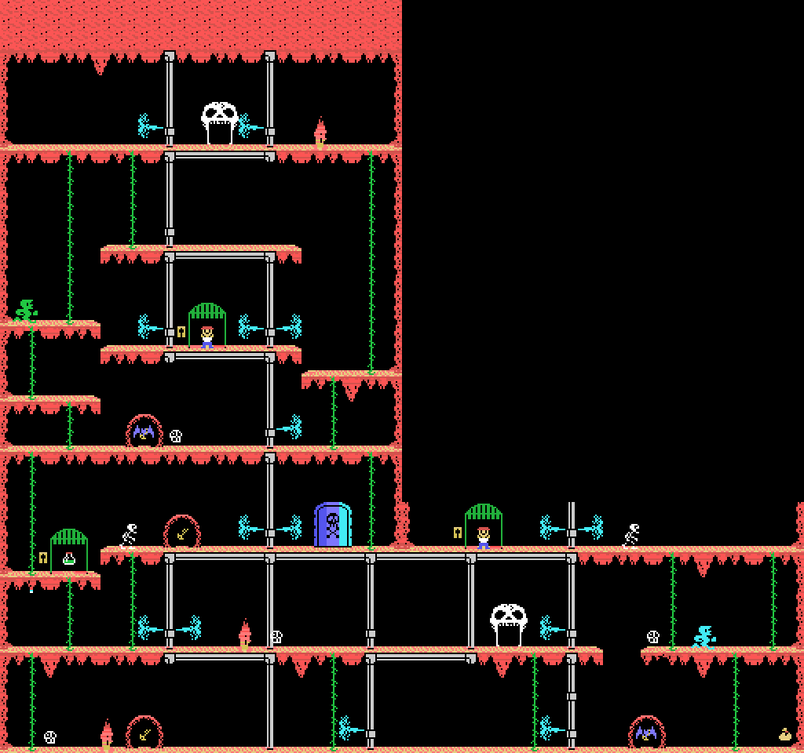

*Nivel 14, las salas repartidas `1- / 2- / 34`. Llaves: cuatro, una en la sala 2, dos en la 3 y una en la 4. Jaulas: un amigo con un candado en la sala 2, un frasco con un candado en la sala 3 y un amigo con un candado en la sala 4. Objeto escondido:  en la sala 4. Puertas de calavera: al nivel 15 desde la sala 1 y al nivel 13 desde la sala 4. Puerta de salida: al nivel 16, el primero de la ronda 4, en la sala 3.*

### Nivel 15

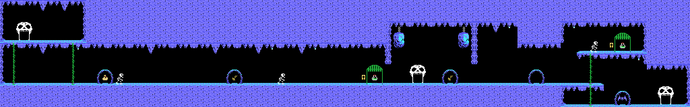

*Nivel 15, las cuatro salas en fila. Llaves: dos, una en la sala 2 y una en la 3. Jaulas: un frasco con un candado en la sala 3 y un frasco con un candado en la sala 4. Objeto escondido: energia en la sala 1. Puertas de calavera: al nivel 11 desde la sala 1, al nivel 12 desde la sala 3, y al nivel 14 desde la sala 4.*

## Ronda 4 — niveles 16 a 20

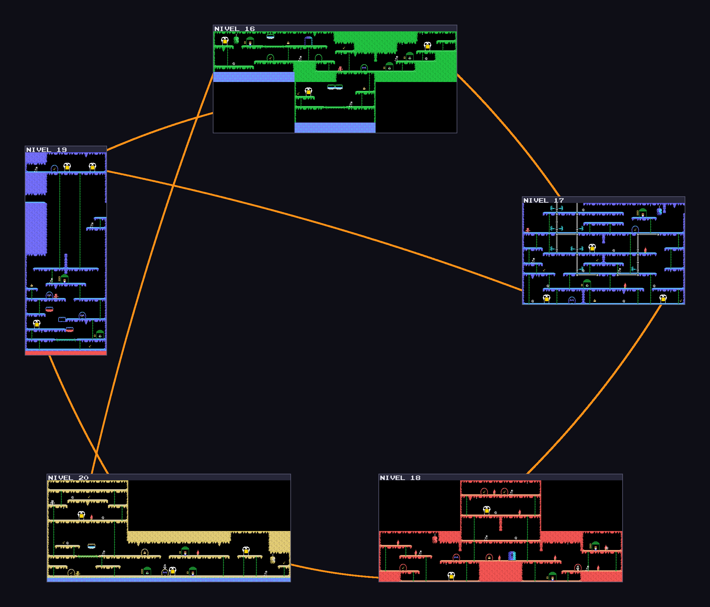

*Los cinco niveles de la ronda 4 y sus puertas de calavera, a 1:1. Cada nivel esta puesto con el reparto de salas que le da 0x52DB, y cada raya une DOS puertas que se emparejan de verdad: la puerta j del nivel A dice (B, k) y la puerta k del nivel B dice (A, j). Las 64 del cartucho emparejan asi, y ninguna sale de su ronda. Las rayas van por detras de los niveles; la marca amarilla es la puerta. Dos cosas de este dibujo NO salen de la ROM, y por eso se dicen: el sitio de cada nivel en el anillo -de los doce ordenes posibles se elige el que menos cruces deja- y la comba de las curvas, que separa las parejas de niveles unidas por DOS puertas.*

### Nivel 16

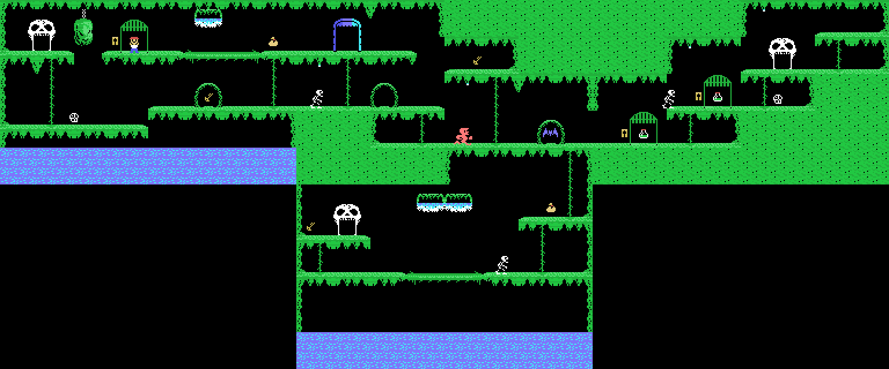

*Nivel 16, las salas repartidas `123 / -4-`. Llaves: tres, una en la sala 1, una en la 2 y una en la 4. Jaulas: un amigo con un candado en la sala 1, un frasco con un candado en la sala 3 y un frasco con un candado en la sala 3. Objetos escondidos:  en la sala 4 y la segunda barra en la sala 1. Puertas de calavera: al nivel 20 desde la sala 1, al nivel 17 desde la sala 3, y al nivel 19 desde la sala 4.*

### Nivel 17

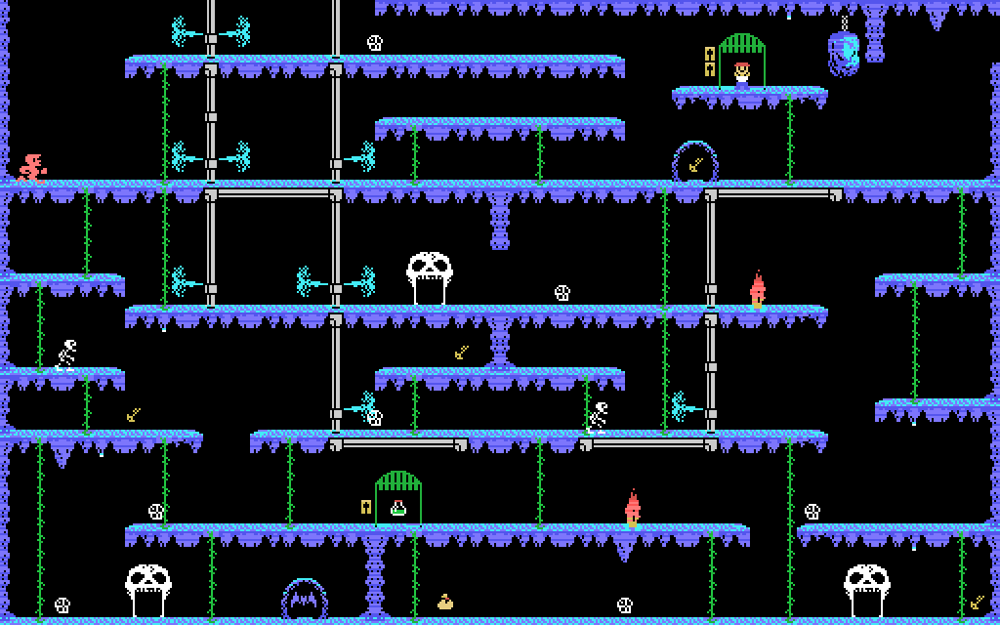

*Nivel 17, las cuatro salas en 2x2. Llaves: cuatro, una en la sala 2, dos en la 3 y una en la 4. Jaulas: un amigo con dos candados en la sala 2 y un frasco con un candado en la sala 3. Objeto escondido:  en la sala 3. Puertas de calavera: al nivel 16 desde la sala 1, al nivel 19 desde la sala 3, y al nivel 18 desde la sala 4.*

### Nivel 18

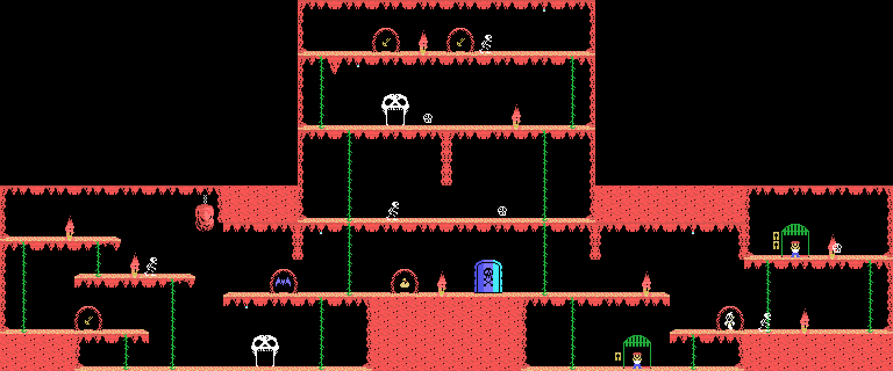

*Nivel 18, las salas repartidas `-1- / 234`. Llaves: cuatro, dos en la sala 1, una en la 2 y una en la 4. Jaulas: un amigo con dos candados en la sala 4 y un amigo con un candado en la sala 4. Objeto escondido:  en la sala 3. Puertas de calavera: al nivel 17 desde la sala 1 y al nivel 20 desde la sala 2. Puerta de salida: al nivel 21, el primero de la ronda 5, en la sala 3.*

### Nivel 19

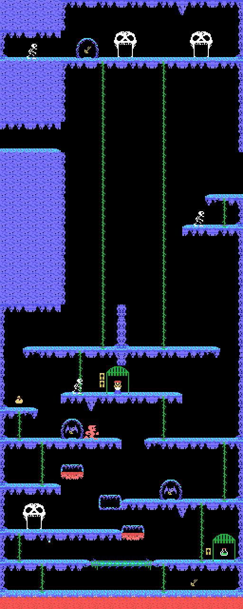

*Nivel 19, las cuatro salas en columna. Llaves: cuatro, una en la sala 1, una en la 3 y dos en la 4. Jaulas: un amigo con dos candados en la sala 3 y un frasco con un candado en la sala 4. Objeto escondido:  en la sala 3. Puertas de calavera: al nivel 16 desde la sala 1, al nivel 17 desde la sala 1, y al nivel 20 desde la sala 4.*

### Nivel 20

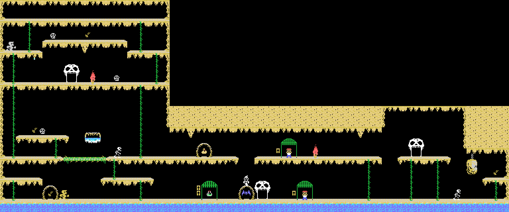

*Nivel 20, las salas repartidas `1-- / 234`. Llaves: cuatro, una en la sala 1, dos en la 2 y una en la 4. Jaulas: un amigo con un candado en la sala 3, un frasco con dos candados en la sala 3 y un amigo con un candado en la sala 3. Objeto escondido:  en la sala 3. Puertas de calavera: al nivel 16 desde la sala 1, al nivel 19 desde la sala 3, y al nivel 18 desde la sala 4.*

## Ronda 5 — niveles 21 a 25

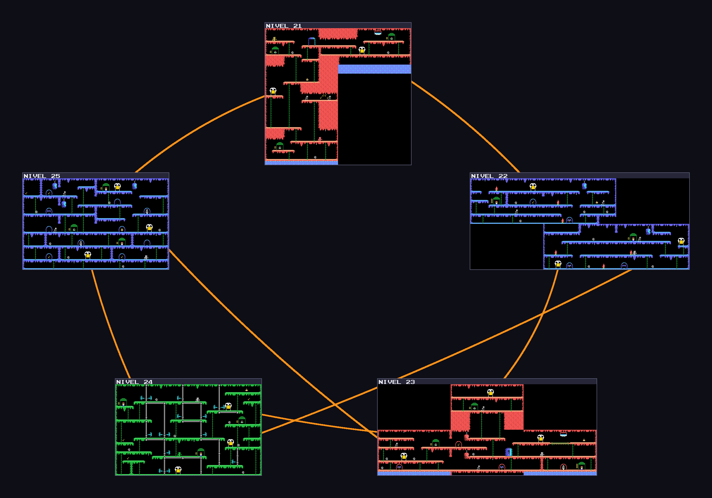

*Los cinco niveles de la ronda 5 y sus puertas de calavera, a 1:1. Cada nivel esta puesto con el reparto de salas que le da 0x52DB, y cada raya une DOS puertas que se emparejan de verdad: la puerta j del nivel A dice (B, k) y la puerta k del nivel B dice (A, j). Las 64 del cartucho emparejan asi, y ninguna sale de su ronda. Las rayas van por detras de los niveles; la marca amarilla es la puerta. Dos cosas de este dibujo NO salen de la ROM, y por eso se dicen: el sitio de cada nivel en el anillo -de los doce ordenes posibles se elige el que menos cruces deja- y la comba de las curvas, que separa las parejas de niveles unidas por DOS puertas.*

### Nivel 21

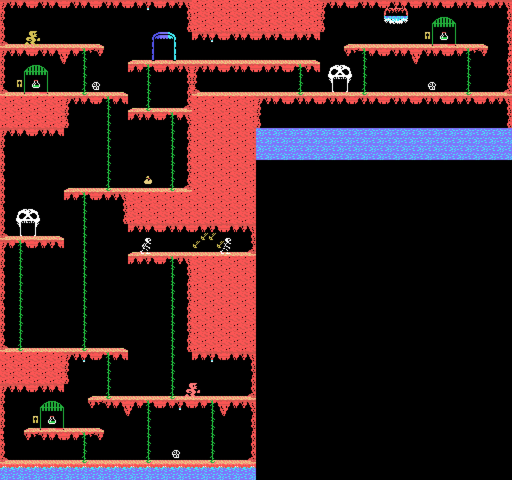

*Nivel 21, las salas repartidas `12 / 3- / 4-`. Llaves: cuatro, todas en la sala 3. Jaulas: un frasco con un candado en la sala 1, un frasco con un candado en la sala 2 y un frasco con un candado en la sala 4. Objeto escondido:  en la sala 3. Puertas de calavera: al nivel 22 desde la sala 2 y al nivel 25 desde la sala 3.*

### Nivel 22

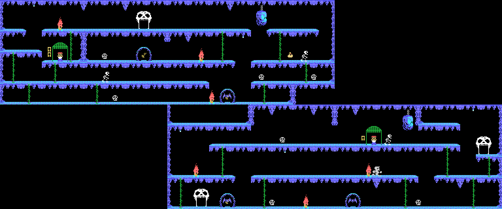

*Nivel 22, las salas repartidas `12- / -34`. Llaves: tres, una en la sala 1, una en la 2 y una en la 3. Jaulas: un amigo con dos candados en la sala 1 y un amigo con un candado en la sala 4. Objeto escondido:  en la sala 2. Puertas de calavera: al nivel 21 desde la sala 1, al nivel 23 desde la sala 3, y al nivel 24 desde la sala 4.*

### Nivel 23

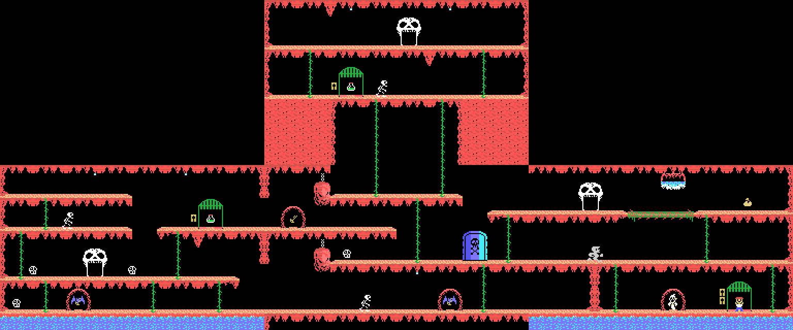

*Nivel 23, las salas repartidas `-1- / 234`. Llaves: cuatro, una en la sala 2, dos en la 3 y una en la 4. Jaulas: un frasco con un candado en la sala 1, un frasco con un candado en la sala 2 y un amigo con dos candados en la sala 4. Objeto escondido:  en la sala 4. Puertas de calavera: al nivel 24 desde la sala 4, al nivel 22 desde la sala 1, y al nivel 25 desde la sala 2. Puerta de salida: al nivel 1, el primero de la ronda 1, en la sala 3.*

### Nivel 24

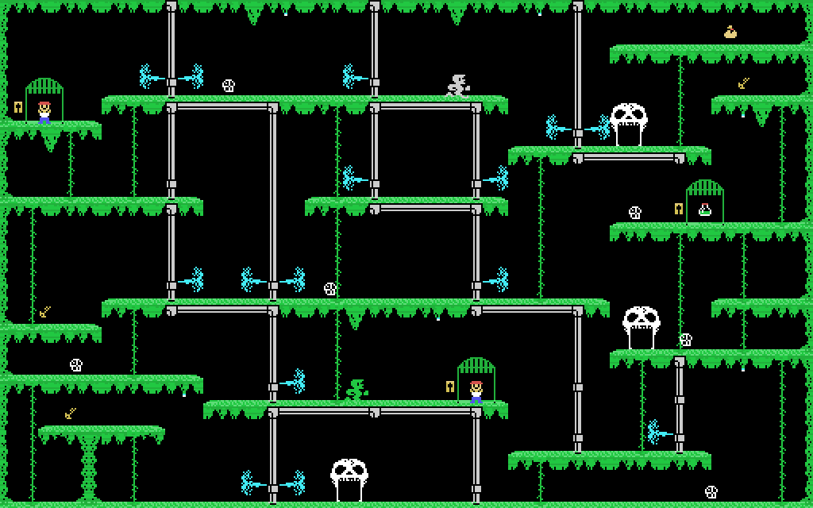

*Nivel 24, las cuatro salas en 2x2. Llaves: tres, una en la sala 2 y dos en la 3. Jaulas: un amigo con un candado en la sala 1, un frasco con un candado en la sala 2 y un amigo con un candado en la sala 4. Objeto escondido:  en la sala 2. Puertas de calavera: al nivel 23 desde la sala 2, al nivel 25 desde la sala 3, y al nivel 22 desde la sala 4.*

### Nivel 25

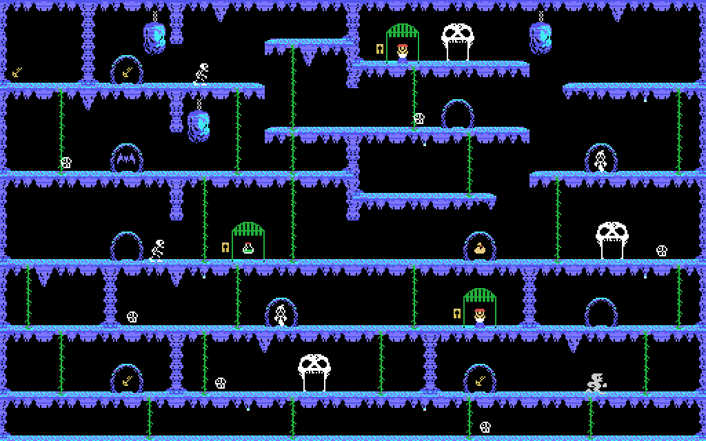

*Nivel 25, las cuatro salas en 2x2. Llaves: cuatro, dos en la sala 1, una en la 3 y una en la 4. Jaulas: un amigo con un candado en la sala 2, un frasco con un candado en la sala 3 y un amigo con un candado en la sala 4. Objeto escondido:  en la sala 4. Puertas de calavera: al nivel 21 desde la sala 2, al nivel 24 desde la sala 3, y al nivel 23 desde la sala 4.*

